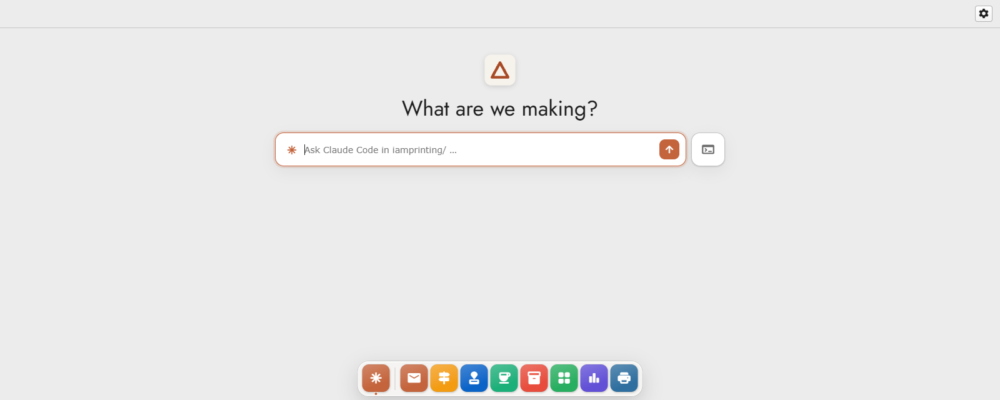
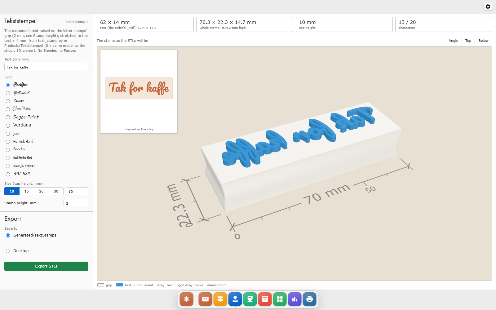
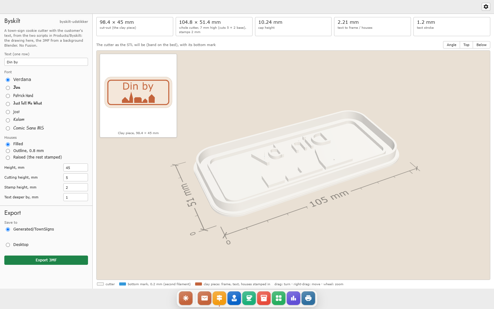
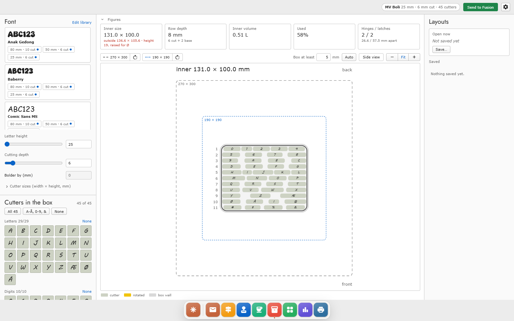
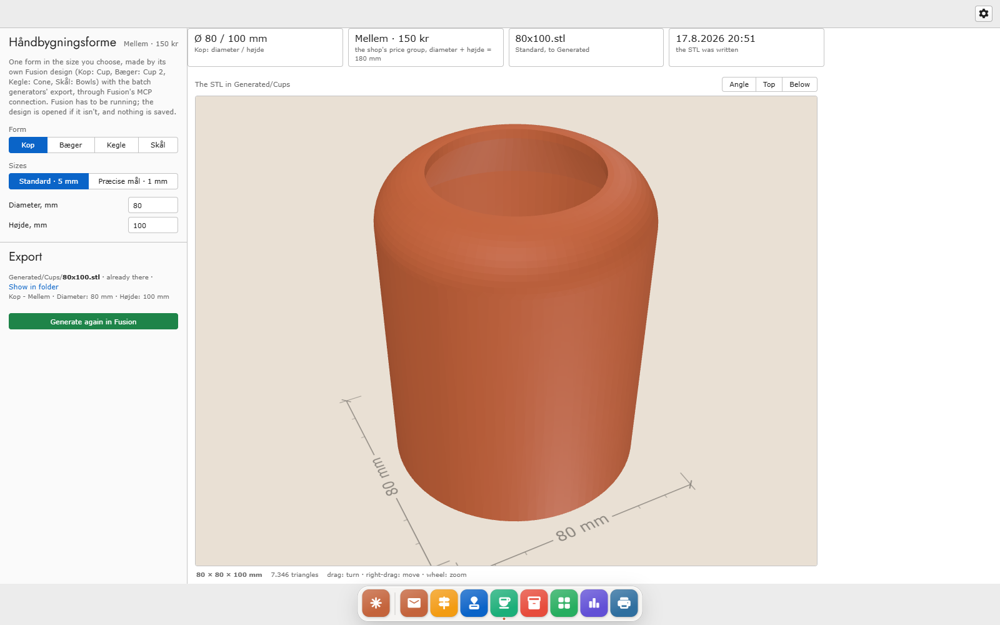
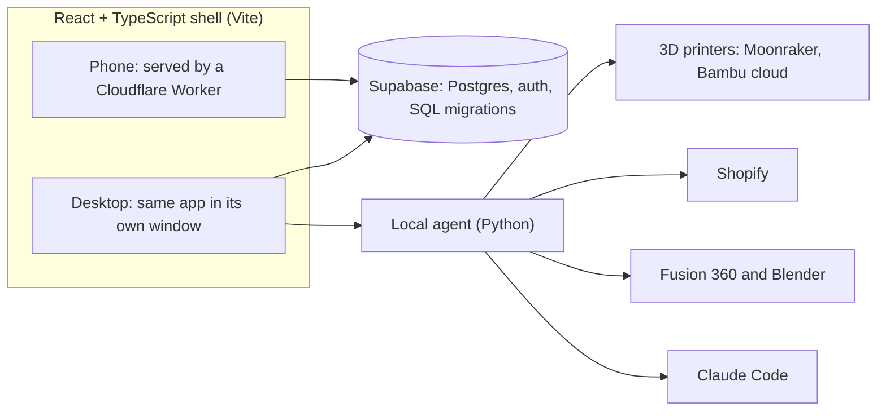

# IAP-HQ

The operating system for my 3D printing business, [iamprinting](https://iamprinting.shop). I design ceramics tools (cookie cutters and letter stamps for clay) in CAD, 3D print them and sell them through a webshop. IAP-HQ is the software I built to run all of it, because nothing off the shelf fit.

> The source code is private, since the repository also holds orders and customer data. This page shows what the app does and how it is built. I'm happy to walk through the code in an interview.

## What it does

**Printers and production**
- Live status for every printer, both Klipper printers (Moonraker API and WebSocket) and a Bambu Lab printer (cloud feed), with camera and material slots
- Print history synced automatically, with material use per print and electricity cost from spot prices
- Spools, materials and stock, so I know what is on the shelf and what a product costs to make

**Orders and sales**
- Orders are fetched from Shopify
- A personal stamp order becomes print files by itself: the customer's text is turned into SVG and STL
- Sales, receipts and bookkeeping in one place

**Product tools**
- Text stamp and town sign generators: customer text in, STL out, with a 3D preview and no CAD work
- Cutter box planner: packs a full set of 45 cookie cutters into layers, finds the smallest box, shows it in 3D on the printer's build plate and sends the plan to Fusion 360
- Hand-building forms: cups, beakers, cones and bowls in any size, generated in Fusion 360
- City map designer: turns map data for an area into a 3D printable city map
- Mug previews: renders a mug stamped with a font in Blender, used as product images in the shop

| | |
|---|---|
|  |  |
|  |  |

The screenshots show the product tools. Views with orders, customers and sales are left out on purpose.

**AI built in**
- Claude Code runs inside the app, with a chat view, permission prompts and several conversations at once
- A custom order from the shop's contact form becomes a prompt, so an agent can start on the task
- AI agents drive Fusion 360 and Blender with instructions I wrote, to model cookie cutters and render product images

## How it is built

- **One shell, two homes.** The same React app runs on my phone (hosted on a Cloudflare Worker) and on the desktop, where a small Python program serves it in its own window.
- **A local agent for everything a browser can't do.** The Python backend talks to the printers, Shopify, Blender, Fusion 360 and Claude Code, reads and writes project files, and takes a nightly backup.
- **Data in Supabase.** Postgres with versioned SQL migrations and row-level security. The desktop keeps print history and prices in sync by itself.
- **Packaged as a real program.** A Windows exe and a macOS app, built with PyInstaller.

## Stack

React, TypeScript, Vite, Supabase (Postgres), Cloudflare Workers, Python, MapLibre, three.js, Shopify, Blender, Fusion 360, Claude Code.

## About the project

A solo project, in daily use since October 2026 and still growing, with about 500 commits so far. It started as a small planner for one product and grew app by app as the business needed more.
